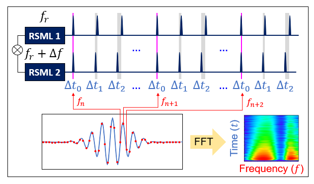
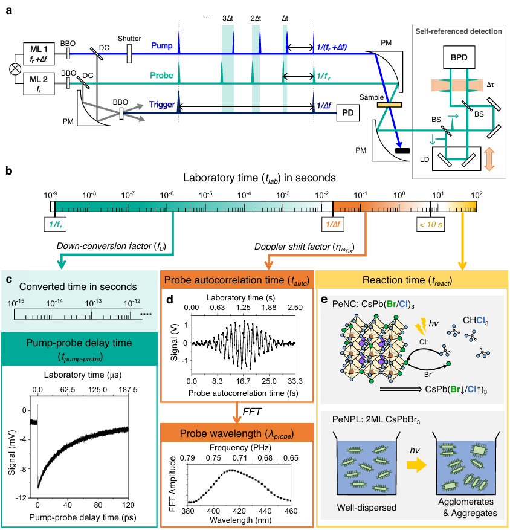
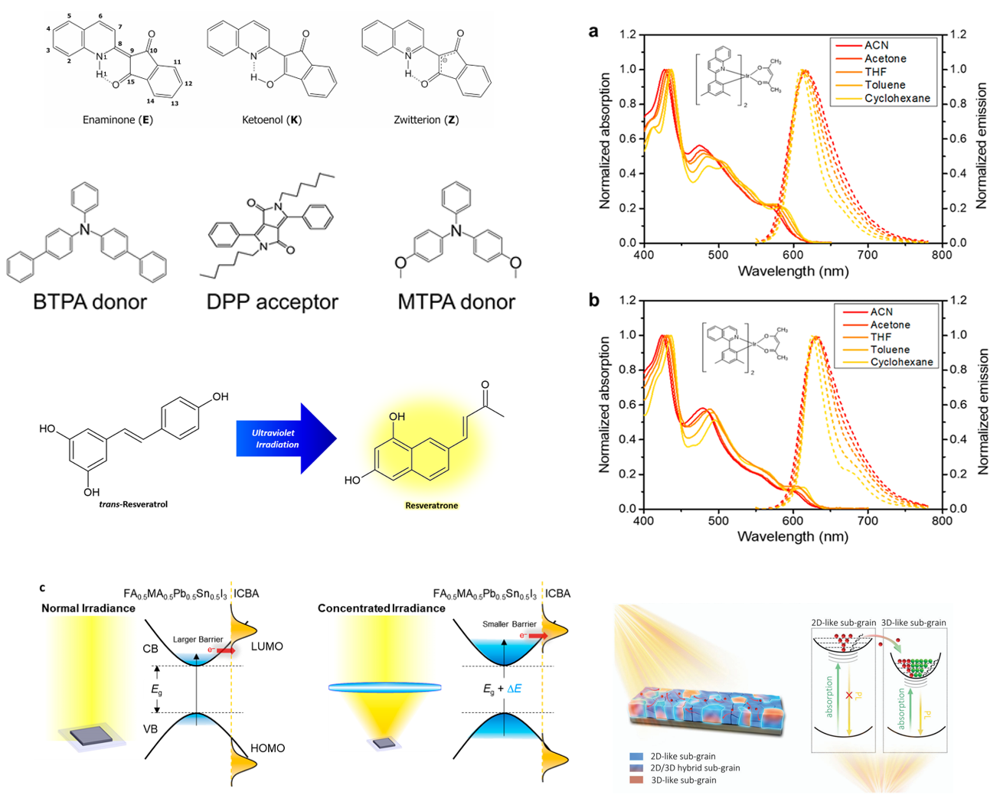
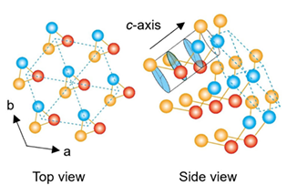

::: {data-lang="en"}
::: {.standard-page .research-page}
# Research

::: {.research-topics}
::: {.research-topic .research-topic-with-project}
01

<h2>Asynchronous and Interferometric Nonlinear Spectroscopy (AI-NS)</h2>

AI-NS combines asynchronously generated laser pulses with interferometric detection. It provides a broad temporal dynamic range, high spectral resolution, and rapid data acquisition without conventional mechanical delay scanning. My work includes AI-TA implementations across near-ultraviolet, near-infrared, and mid-infrared spectral regions.

<strong>Methods:</strong> AI-NS · AI-TA · ASOPS · coherent averaging · optical frequency combs

Current instrumentation development extends AI-NS across spectral windows, with an emphasis on coherent averaging and long-term measurement stability.

<figure class="research-figure"></figure>
<section class="research-project" aria-labelledby="ysf-heading-en">
<h3 id="ysf-heading-en">IBS Young Scientist Fellowship research</h3>

<strong>Selected in 2026 · Principal investigator</strong>

<strong>Project title:</strong> Expanding the scopes of multidimensional spectroscopy using asynchronous and interferometric nonlinear spectroscopy

An independent research program developing time-resolved optical-frequency-comb spectroscopy and applying it to complex photophysical systems.

</section>
:::

::: {.research-topic .research-topic-image-left}
02

<h2>In situ ultrafast spectroscopy</h2>

Ultrafast measurements are performed while the sample undergoes slower photochemical or structural change. Current projects follow carrier dynamics during photoinduced ion exchange, aggregation, and structural evolution in perovskite nanomaterials. This approach links carrier and exciton dynamics to the evolving state of the sample.

<strong>Focus:</strong> real-time measurement · photoinduced reactions · heterogeneous samples

<figure class="research-figure research-figure-fit-text"></figure>
:::

::: {.research-topic}
03

<h2>Photophysics of functional materials</h2>

Transient absorption, photoluminescence, and complementary spectroscopy are used to determine how charges and excitons are generated, transferred, and relaxed in molecular and solid-state systems.

<strong>Systems:</strong> perovskites · organic chromophores · OLED emitters · photovoltaic materials

<figure class="research-figure research-figure-fit-text"></figure>
:::

::: {.research-topic .research-topic-image-left}
04

<h2>Mid-infrared carrier and phonon dynamics</h2>

Mid-infrared AI-TA directly probes band-edge carrier relaxation and coupled structural dynamics in narrow-bandgap semiconductors, including tellurium and InAs.

<strong>Topics:</strong> band-edge carriers · coherent phonons · structural relaxation

<figure class="research-figure research-figure-fit-text"></figure>
:::
:::

:::
:::

::: {data-lang="ko"}
::: {.standard-page .research-page}
# 연구

::: {.research-topics}
::: {.research-topic .research-topic-with-project}
01

<h2>비동기·간섭 비선형 분광법 (AI-NS)</h2>

AI-NS는 서로 비동기적으로 생성된 레이저 펄스와 간섭 검출을 결합한 분광법입니다. 기계식 지연 주사 없이 넓은 시간 범위, 높은 스펙트럼 분해능, 빠른 데이터 획득을 구현합니다. 근자외선·근적외선·중적외선 영역의 AI-TA 장비와 측정법을 연구하고 있습니다.

<strong>방법:</strong> AI-NS · AI-TA · ASOPS · 결맞음 평균 · 광주파수 빗살

다양한 파장 영역으로 AI-NS 장비를 확장하며, 결맞음 평균과 장시간 측정 안정성을 향상하는 연구를 수행합니다.

<figure class="research-figure"></figure>
<section class="research-project" aria-labelledby="ysf-heading-ko">
<h3 id="ysf-heading-ko">IBS Young Scientist Fellowship 연구</h3>

<strong>2026년 선정 · 연구책임자</strong>

<strong>과제명:</strong> Expanding the scopes of multidimensional spectroscopy using asynchronous and interferometric nonlinear spectroscopy

시간분해 광주파수 빗살 분광법을 개발하고 복잡한 광물리 시스템에 적용하는 독립 연구 프로그램입니다.

</section>
:::

::: {.research-topic .research-topic-image-left}
02

<h2>In situ 초고속 분광학</h2>

시료가 느린 광화학 반응이나 구조 변화를 겪는 동안 초고속 측정을 연속적으로 수행합니다. 현재 페로브스카이트 나노소재의 광유도 이온 교환, 응집, 구조 변화 과정에서 전하 운반자 동역학을 측정하고 있습니다. 이를 통해 전하·엑시톤 동역학을 시료의 변화와 직접 연결합니다.

<strong>주제:</strong> 실시간 측정 · 광유도 반응 · 불균일 시료

<figure class="research-figure research-figure-fit-text"></figure>
:::

::: {.research-topic}
03

<h2>기능성 소재의 광물리</h2>

과도흡수, 발광 및 보완 분광법을 이용하여 분자와 고체 소재에서 전하와 엑시톤이 생성·이동·이완하는 과정을 규명합니다.

<strong>소재:</strong> 페로브스카이트 · 유기 색소 · OLED 발광체 · 태양전지 소재

<figure class="research-figure research-figure-fit-text"></figure>
:::

::: {.research-topic .research-topic-image-left}
04

<h2>중적외선 전하 운반자·포논 동역학</h2>

중적외선 AI-TA를 이용하여 텔루륨과 InAs 같은 좁은 밴드갭 반도체의 밴드 가장자리 전하 이완과 구조 동역학을 직접 관찰합니다.

<strong>주제:</strong> 밴드 가장자리 전하 · 결맞음 포논 · 구조 이완

<figure class="research-figure research-figure-fit-text"></figure>
:::
:::

:::
:::
